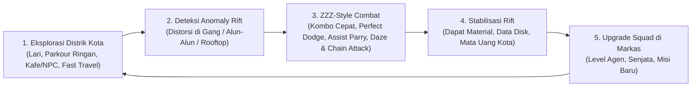
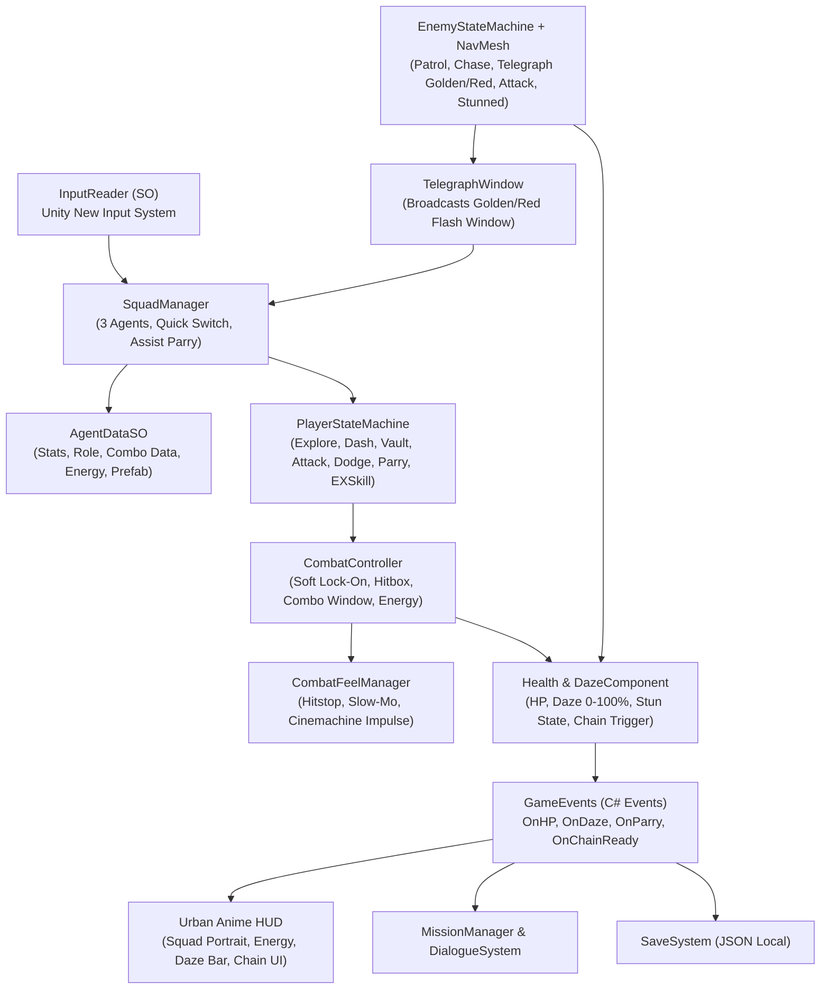

# Game Design Document (GDD) & Arsitektur Teknis
**Working Title:** Project Neo-Veil *(bisa diganti sesuai keinginanmu)*  
**Genre:** Indie 3D Urban Supernatural Anime Action-RPG (Semi-Open World × Stylish Combat)  
**Inspirasi Utama:** Dunia & eksplorasi urban ala *Neverness to Everness (NTE)* + Combat cepat & responsif ala *Zenless Zone Zero (ZZZ)*  
**Engine Rekomendasi:** **Unity 6 LTS (6000.0 LTS)** — **URP (Universal Render Pipeline, Forward+ Path)**  
**Target Platform:** PC (Windows) dulu, arsitektur siap untuk Mobile (Android/iOS)  
**Skala Tim:** Solo Developer + AI Coding Assistant

---

## 1. Kenapa Unity 6 LTS (URP Forward+)?

Untuk tema kota modern anime (*Neverness to Everness*) + efek combat neon (*ZZZ*), **Unity 6 LTS (6000.0 LTS)** adalah pilihan terbaik saat ini:
- **Forward+ Rendering di URP:** Sangat krusial untuk kota modern karena bisa merender **banyak lampu jalan, papan neon, dan cahaya skill combat** tanpa lag seperti batas lampu di Unity versi lama.
- **Cinemachine 3 & Input System Terbaru:** Bawaan lebih bersih untuk kamera combat dinamis, *lock-on*, *camera shake*, dan dukungan penuh Keyboard/Mouse + Gamepad + Mobile.
- **Gratis (Unity Personal):** Bebas biaya lisensi selama pendapatan game masih di bawah \$200.000/tahun dan tanpa *splash screen* wajib di Unity 6.

---

## 2. Batasan Scope Indie (Realistis & Bisa Selesai)

| Aspek | Skala AAA (NTE / ZZZ) | Skala Indie Kita (Versi 1.0 / Demo) |
| :--- | :--- | :--- |
| **Dunia / Map** | Kota metropolitan raksasa + interior penuh | **1 Distrik Kota Semi-Open World** (~350m × 350m) berisi jalan utama neon, alun-alun, gang, rooftop, dan 1 Kafe/Markas |
| **Zona Pertarungan** | Transisi kota + dungeon besar | **Anomaly Rift** di titik-titik distrik (arena pertarungan supranatural langsung di jalanan atau distorsi kota) |
| **Karakter Playable** | Puluhan agen | **3 Agen (1 Squad)** dengan peran jelas: *Attack (DPS)*, *Stun (Breaker)*, *Support (Anomaly)* |
| **Mode Game** | Live-service online + Gacha | **100% Single-Player Offline** (rekrut/upgrade agen lewat progresi cerita & misi kota) |
| **Musuh** | Puluhan faksi | **3 Tipe Musuh Anomali** (Fast Stalker, Ranged Turret/Caster, 1 Elite Anomaly Boss) |
| **Visual** | High-end UE5 / custom shader | **Stylized Urban Anime** (Cel-shaded + URP Bloom untuk papan neon & efek parry) |

> [!TIP]
> **Trik Efisiensi Kota Indie:** Kamu tidak perlu membuat semua gedung bisa dimasuki! Cukup buat **1 interior penuh (Kafe / Markas Squad)**, sementara gedung lain berupa fasad luar bergaya anime dengan jendela bercahaya, gang kecil, tangga ke rooftop, dan 3–4 *Anomaly Rift* di jalanan.

---

## 3. Core Gameplay Loop



---

## 4. Desain Eksplorasi (Ala Neverness to Everness Skala Indie)

- **Gerakan Urban:** Jalan santai, Sprint cepat, **Dash**, Lompat, dan **Parkour Ringan** (*vault* melewati pagar rendah & *ledge climb* naik ke atap/balkon pendek). *(Lebih cocok dengan nuansa kota modern daripada gliding pedesaan, tapi tetap bisa ditambah grapple/air-dash jika diinginkan.)*
- **Atmosfer Kota Hidup:**
  - **Siklus Siang–Sore–Malam:** Papan neon, lampu jalan, dan pantulan aspal menyala otomatis saat malam!
  - **Titik Fast Travel:** Halte Bus / Pintu Stasiun Metro di 3–4 sudut distrik.
  - **Interaksi Kota (`F`):** Bicara dengan NPC, beli buff sementara di *vending machine* / kafe, buka *Anomaly Crate*, dan ambil kontrak misi di papan markas.

---

## 5. Desain Combat (Ala Zenless Zone Zero)

Ini adalah daya tarik utama game kita. Kunci rasa combat *ZZZ* bukan di animasi mahal, melainkan di **responsivitas, timing flash, dan feedback (juice)**:

### A. Kontrol Combat
- `WASD` + `Mouse`: Gerak & kamera *third-person* dengan **Soft Lock-On** (serangan otomatis mengarah ke musuh terdekat).
- `Left Click`: **4-Hit Basic Attack Combo** (dengan *Attack Lunge* maju sedikit tiap pukulan agar tidak meleset).
- `E`: **Special Attack / EX Special** (saat Energy cukup, berubah jadi *EX Special* lebih kuat dengan *i-frame*).
- `Q`: **Ultimate** (saat *Decibel / Ultimate Gauge* mencapai 100%).
- `Right Click` / `Shift`: **Dodge** — jika tepat sebelum serangan musuh mengenai kita → memicu **Perfect Dodge** (*slow-motion* 0.35 detik + klik serang langsung menjadi **Dodge Counter**).
- `Space` / `Tab` (atau `1 / 2 / 3`): **Quick Switch / Defensive Assist**.

### B. Sistem Telegraph Flash & Defensive Assist (Ciri Khas ZZZ)
Setiap serangan musuh memiliki aba-aba visual & suara (*telegraph*) tepat sebelum mengenai pemain:
1. **Kilatan Emas (*Golden Flash*):** Pemain bisa menekan **Switch (`Space` / `Tab`)** tepat waktu → memicu **Defensive Assist (Perfect Parry)!**
   - Karakter berikutnya langsung melompat masuk ke depan, menangkis serangan dengan *hitstop* (jeda 50ms), percikan cahaya besar, suara *CLANG!* nyaring, dan mengisi **Daze Bar** musuh secara drastis.
2. **Kilatan Merah (*Red Flash*):** Serangan tidak bisa di-parry → pemain wajib melakukan **Perfect Dodge** (`Right Click` / `Shift`) lalu membalas dengan **Dodge Counter**.

### C. Daze Bar, Stun & Chain Attack
- Setiap musuh memiliki **HP Bar** (merah) dan **Daze Bar** (kuning, 0–100%).
- Saat **Daze Bar mencapai 100%**, musuh masuk kondisi **Stunned** selama 6–8 detik:
  - Musuh berhenti menyerang dan menerima **Damage ×1.5**.
  - Memicu **Chain Attack Prompt** (waktu melambat 1.5 detik → pemain pilih karakter berikutnya untuk langsung melancarkan serangan kombo masuk otomatis!).

### D. 3 Agen dalam Squad
| Slot | Peran (Role) | Senjata | Fokus Gameplay |
| :--- | :--- | :--- | :--- |
| **1** | **Striker (Attack / DPS)** | Dual Blades / Katana | Kombo sangat cepat, burst damage terbesar saat musuh *Stunned*. |
| **2** | **Breaker (Stun)** | Gauntlet / Palu Energi | Mengisi **Daze Bar** musuh 2× lebih cepat, spesialis **Defensive Assist Parry**. |
| **3** | **Channeler (Support / Anomaly)** | Pistol / Orbit Drone | Serangan jarak menengah, memberi buff ATK ke tim, dan memicu ledakan *Anomaly*. |

### E. "Combat Juice" Wajib (Rahasia Rasa ZZZ)
- **Hitstop (Freeze Frame):** Hentikan animasi & *timeScale* selama `0.03–0.06 detik` saat serangan berat atau Parry masuk.
- **Camera Shake & Zoom:** Pakai `CinemachineImpulseSource` untuk getaran kamera halus di tiap hit dan dorongan kamera saat *Perfect Parry*.
- **VFX Minimalis tapi Tajam:** Garis tebasan (*slash trail*), kilatan bintang emas/merah saat telegraph, dan angka damage pop-up yang memantul.

---

## 6. Arsitektur Teknis Unity 6 (URP)



### Struktur Folder Proyek Unity
```text
Assets/
└── _Project/
    ├── Art/
    │   ├── Characters/          # Model VRoid (streetwear anime) + animasi Mixamo
    │   ├── CityEnvironment/     # Jalan, gedung, lampu neon, kafe, props kota
    │   ├── VFX/                 # Slash trails, Golden/Red Flash, Parry sparks, Anomaly fog
    │   └── Shaders/             # lilToon / URP Cel-Shader + Hologram Anomaly Shader
    ├── Audio/
    │   ├── BGM/                 # Synth-pop / Urban electronic / Battle theme
    │   └── SFX/                 # Slash, Parry CLANG, Dodge whoosh, UI click
    ├── Prefabs/
    │   ├── Squad/               # 3 Prefab Agen + hitbox
    │   ├── Enemies/             # 3 Tipe Musuh Anomali
    │   ├── City/                # Anomaly Rift, Bus Stop Waypoint, Vending Machine
    │   └── UI/                  # HUD, Chain Attack Banner, Damage Popup
    ├── Scenes/
    │   ├── Boot.unity
    │   ├── MainMenu.unity
    │   ├── District01_NeonWard.unity   # Semi-Open World Kota
    │   └── Interior_CafeHub.unity      # Markas Squad (opsional additive scene)
    ├── ScriptableObjects/
    │   ├── Agents/              # Data 3 Agen (Striker, Breaker, Channeler)
    │   ├── Attacks/             # AttackDataSO (damage, daze, hitstop, knockback, lunge)
    │   └── Missions/            # Data kontrak misi & dialog NPC
    └── Scripts/
        ├── Core/                # InputReader, TimeScaleManager, GameEvents, SaveSystem
        ├── Player/              # PlayerStateMachine, States (Move, Dodge, Attack, Assist)
        ├── Squad/               # SquadManager, AgentDataSO, ChainAttackController
        ├── Combat/              # Hitbox, SoftLockOn, HealthComponent, DazeComponent, AttackDataSO
        ├── AI/                  # EnemyFSM, TelegraphSystem (Golden/Red), AnomalyRiftSpawner
        ├── City/                # Interactable, DayNightNeonController, FastTravelStop
        ├── Quest/               # DialogueSystem, MissionManager
        └── UI/                  # CombatHUD, DamagePopup, StunBarUI, ChainPromptUI
```

---

## 7. Pipeline Aset Gratis untuk Tema Urban Anime (NTE × ZZZ)

| Kebutuhan | Alat / Sumber Gratis | Tips Penggunaan |
| :--- | :--- | :--- |
| **Karakter Streetwear Anime** | **VRoid Studio** + **UniVRM** | Sangat cocok untuk outfit modern/jaket/hoodie ala NTE & ZZZ. |
| **Animasi Combat Cepat** | **Mixamo** | Cari keyword: `sword slash`, `mma kick`, `dodge roll`, `parry`, `sprint`. Percepat playback speed `1.2x–1.4x` di Animator agar terasa *snappy* seperti ZZZ! |
| **Shader Anime + Neon** | **lilToon** (GitHub, gratis) + **URP Post-Processing Bloom** | Kombinasi *cel-shading* karakter + *Bloom* pada lampu neon & efek parry langsung memberi nuansa ZZZ/NTE. |
| **Lingkungan Kota** | **Unity Asset Store (Free Stylized/Japanese/Modern City Packs)**, **Quaternius**, **Kenney City Kit** | Mulai dari *greybox* jalan & balok gedung dulu, lalu ganti aset kota secara bertahap. |
| **SFX Combat & Kota** | **Freesound.org**, **Pixabay**, **Sonniss GDC Free Audio** | Suara *Parry metallic ring* dan *slow-mo bass drop* saat Perfect Dodge bikin combat terasa 10× lebih keren. |

---

## 8. Roadmap Pengembangan 6 Fase

| Fase | Fokus Utama | Target *Milestone* | Estimasi |
| :--- | :--- | :--- | :--- |
| **Fase 0** | **Setup Unity 6 URP** | Proyek Unity 6 LTS (URP Forward+), New Input System, Cinemachine 3, struktur folder, arena *greybox* jalan kota. | 2–3 hari |
| **Fase 1** | **Movement, Dodge & Soft Lock-On** | Gerak *third-person* responsif, sprint, dash, **Dodge dengan i-frame**, kamera Cinemachine, dan *Soft Lock-On* ke target. | 1–2 minggu |
| **Fase 2** | **ZZZ Core Combat & Squad** | 4-hit combo (`AttackDataSO`), *Attack Lunge*, **Hitstop & Camera Shake**, **Squad Switch (3 Agen)**, EX Special, dan Ultimate Gauge. | 2–3 minggu |
| **Fase 3** | **Enemy AI, Parry & Daze/Chain** | AI musuh dengan **Golden Flash (Defensive Assist Parry)** & **Red Flash (Perfect Dodge)**, **Daze Bar**, Stun state, dan **Chain Attack**. | 2–3 minggu |
| **Fase 4** | **Distrik Kota Semi-Open World** | Blok kota 350m×350m, siklus Siang–Malam dengan lampu neon otomatis, *Anomaly Rift* spawner, Fast Travel halte, interaksi (`F`). | 2–3 minggu |
| **Fase 5** | **Markas Kafe, Misi & Save** | NPC kota, sistem dialog, 1 Main Mission + 2 Side Contract, upgrade agen sederhana, Save/Load JSON, Pause/Settings. | 2 minggu |
| **Fase 6** | **Urban Anime Polish & Build** | Model VRoid + lilToon, VFX slash & parry sparks, URP Bloom, BGM synth/urban + SFX, optimasi FPS, build Demo `.exe`. | 2–3 minggu |

---

## 9. Template Prompt AI Siap Pakai (Khusus Unity 6 + ZZZ Combat)

### Prompt Fase 1 — Controller, Dodge & Soft Lock-On
```text
Saya sedang membuat game indie 3D Urban Anime Action-RPG di Unity 6 LTS (URP Forward+, New Input System, Cinemachine 3) dengan combat gaya Zenless Zone Zero.

Kita masuk ke Fase 1. Buatkan script C# yang modular dan bersih untuk:
1. InputReader.cs (ScriptableObject wrapper untuk Move, Look, Attack, Dodge, Special, Ultimate, SwitchNext, Interact).
2. TimeScaleManager.cs (singleton ringan untuk efek Hitstop freeze-frame 0.04 detik dan Perfect Dodge slow-motion 0.35 detik tanpa bentrok).
3. SoftLockOnSystem.cs (mencari musuh terdekat dalam radius & arah input kamera agar serangan otomatis menghadap target).
4. PlayerMovementController.cs (CharacterController, gerak responsif relatif kamera, sprint, dan Dodge dengan jendela i-frame serta deteksi Perfect Dodge).

Sertakan panduan setup langkah demi langkah di Unity 6 Inspector.
```

### Prompt Fase 2 & 3 — ZZZ Combat, Golden/Red Telegraph & Defensive Assist Parry
```text
Melanjutkan proyek Unity 6 LTS (URP) Action-RPG gaya ZZZ. Sekarang kita bangun inti sistem combat:
1. AttackDataSO.cs (ScriptableObject berisi damage, dazeAmount, hitstopDuration, lungeForce, dan comboWindow).
2. HealthAndDazeComponent.cs (mengelola HP, Daze Bar 0-100%, status Stunned dengan multiplier damage 1.5x, serta event OnStunTriggered untuk memicu Chain Attack).
3. TelegraphSystem.cs pada musuh yang memicu jendela serangan tipe GoldenFlash (bisa di-Parry) atau RedFlash (wajib Dodge) beserta event visual/audio.
4. SquadManager.cs untuk 3 agen (Striker, Breaker, Channeler) yang mendukung Quick Switch biasa dan Defensive Assist Parry saat pemain menekan tombol Switch di dalam jendela GoldenFlash musuh.

Gunakan C# Events agar HUD dan VFX bisa terhubung secara decoupled.
```
